<div align="center">
  
  <h1>ShopNexa Mobile</h1>
  <p>A mobile-first marketplace experience for everyday shopping, independent sellers, and marketplace operations.</p>
  <p><strong>Expo · React Native · Android · iOS</strong></p>
</div>

---

## App overview

ShopNexa is a cross-platform shopping app with a guest-friendly storefront and separate customer, shop-owner, and administrator journeys. Customers can discover categories, browse products, save favourites, manage delivery details, choose payment methods, and follow orders. Shop owners manage their store and catalogue; administrators use a mobile ERP control room for marketplace operations.

The home experience includes an illustrated campaign carousel and image-led category cards. Navigation is available through the bottom tabs and the scrollable side drawer. The drawer also provides ten accent colours and system appearance choices.

## Fresh app screenshots

These screenshots were captured from the Android app running in a Pixel 7 Pro emulator on October 26, 2026. They include the guest flow, local catalogue fallback, and empty states shown before an account has customer data.

| Onboarding | Home, campaigns and category cards |
|---|---|
| 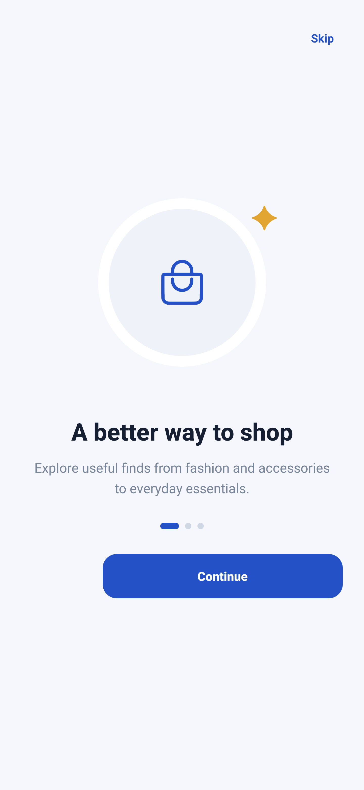 |  |

| All category cards | Discover products |
|---|---|
| 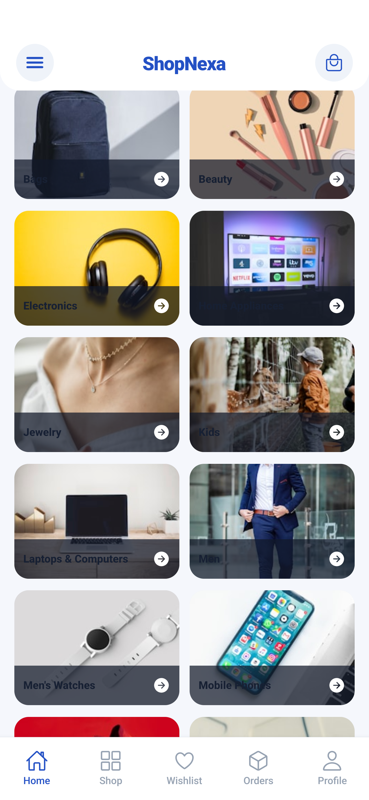 | 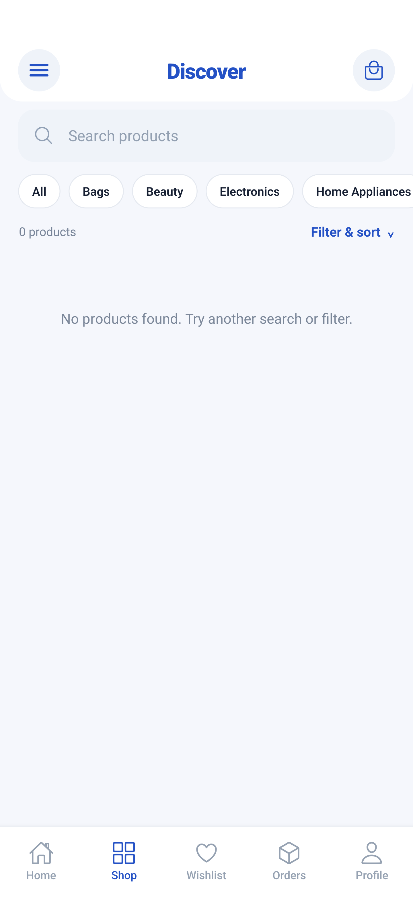 |

| Wishlist empty state | Orders empty state |
|---|---|
| 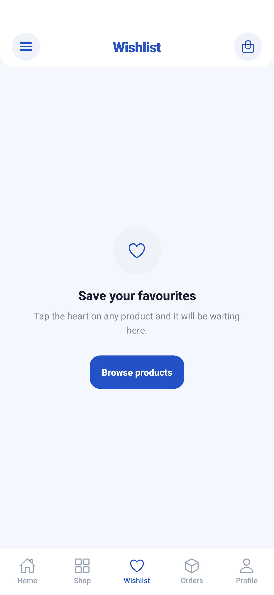 | 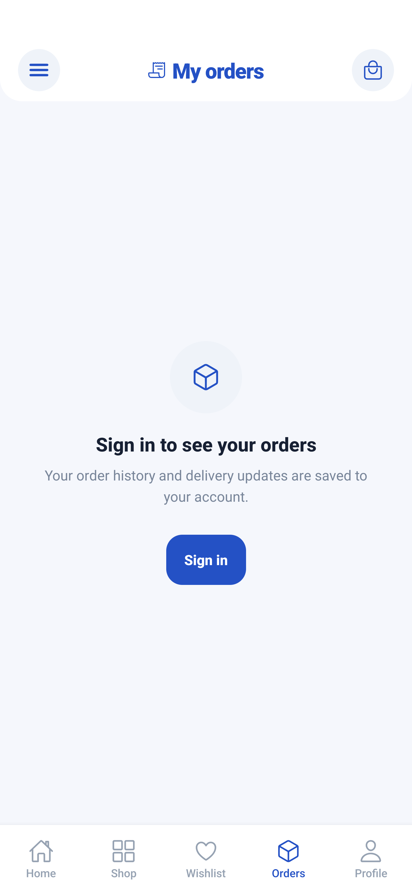 |

| Profile as guest | Sign in and role selection |
|---|---|
| 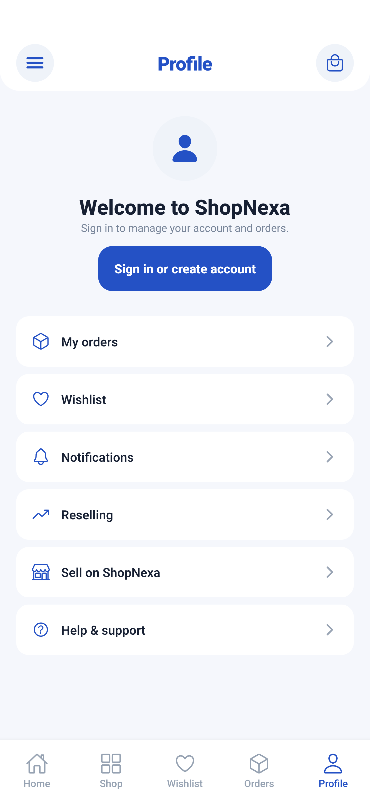 | 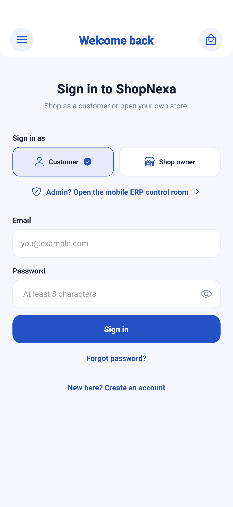 |

| Create account and customer or shop-owner choice | Full navigation drawer, theme controls and categories |
|---|---|
| 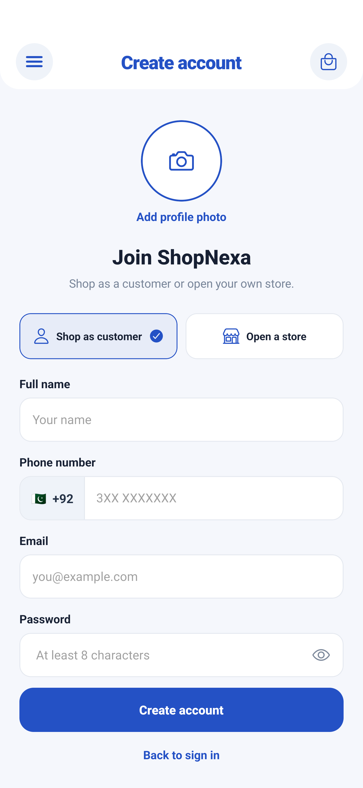 | 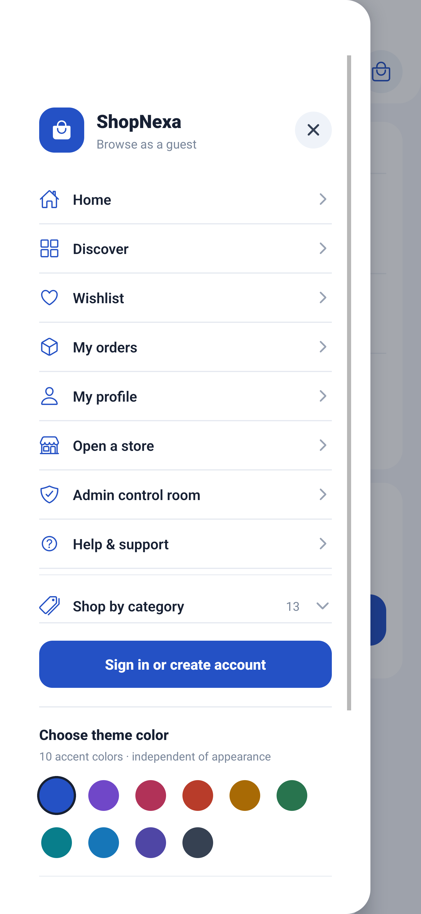 |

| Help and support | Shopping bag empty state |
|---|---|
| 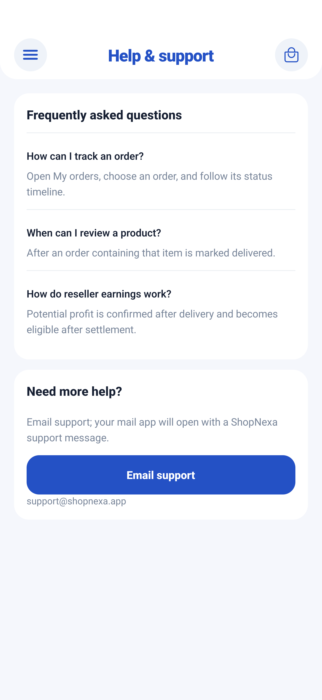 | 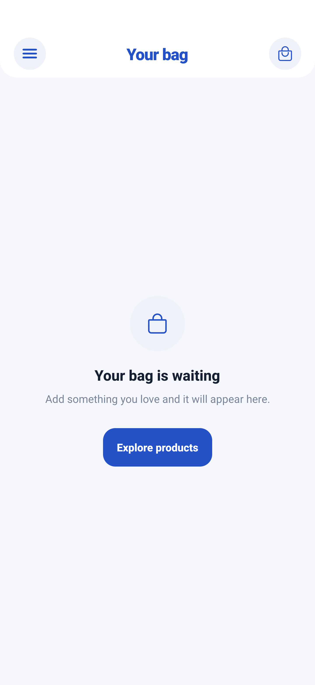 |

| Drawer appearance controls | Product cards |
|---|---|
| 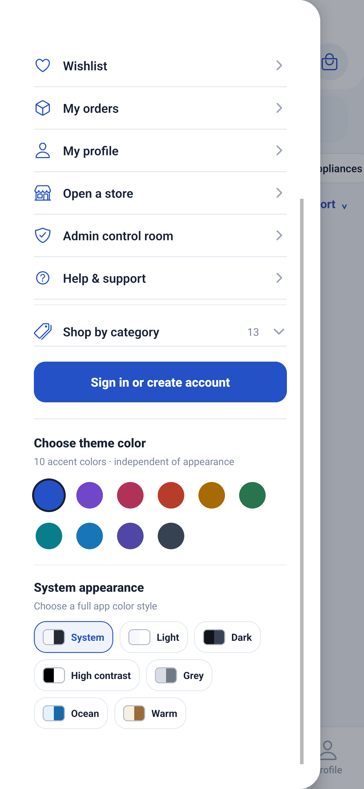 |  |

| Product details | Admin mobile sign-in |
|---|---|
| 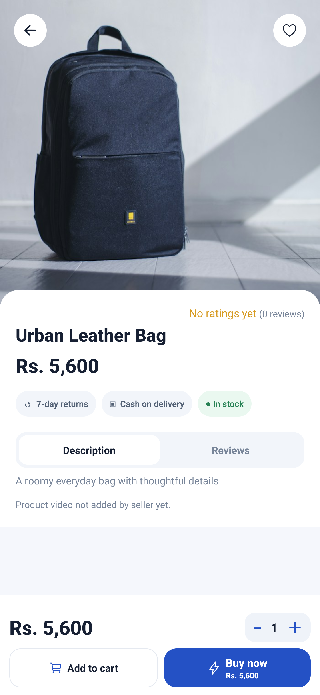 | 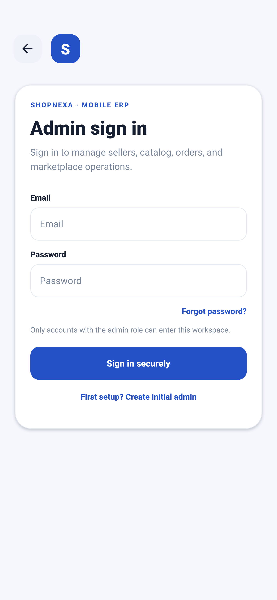 |

> Checkout, saved addresses, linked wallets, seller tools, and the admin dashboard depend on a reachable API and the appropriate account role. The admin sign-in screen is included; authenticated dashboards and populated account data are not fabricated. Connect the backend and sign in with demo data to view those states.

## Screen and component map

### Shopper experience

- **Onboarding** — three-slide introduction with skip and continue actions.
- **Home** — campaign slider, category cards, product discovery, search, and bag shortcut.
- **Discover / Shop** — category filters, search, sorting, and product grid.
- **Product details** — image gallery, reviews, options, seller comparison, wishlist, add to bag, and buy now.
- **Shopping bag** — quantity controls and order summary.
- **Checkout** — saved delivery information, delivery selection, and payment method.
- **Address book** — reusable shipping and billing details.
- **Orders and order details** — status and shipment timeline.
- **Wishlist, notifications, reviews, and help/support**.
- **Profile** — customer details, appearance, and account links.
- **Wallets and banks** — popular wallets, other wallet providers, bank accounts, and demo credit/debit card details.

### Seller and marketplace operations

- **Shop owner onboarding and seller centre** — store profile, catalogue, and orders.
- **Admin control room** — mobile-only admin login/setup and marketplace overview, store sales, users, sellers, products, orders, categories, banners, and reseller earnings.
- **Reselling** — shareable product pricing and earnings state.

### Reusable UI components

- Branded header, search field, drawer, bottom tabs, campaign card, category card, product card, seller row, rating/review block, wallet/bank mark, address form, payment selector, order timeline, empty state, and themed confirmation dialogs.

## Technology

- Expo SDK 58 and React Native 0.88
- React Navigation native stack and bottom tabs
- Axios for the backend API
- AsyncStorage for shopper preferences and local state
- Expo SecureStore for protected admin session tokens
- Expo Image Picker for profile and seller product media
- Expo Status Bar and vector icons

## Project layout

```text
mobile/
├── App.js                     # App state, navigation, and shopper screens
├── src/
│   ├── data/catalog.js        # Category and catalogue presentation data
│   └── screens/AdminScreen.js # Mobile administrator workspace
├── assets/                    # Home artwork, bank and wallet marks, app logo
├── docs/screenshots/          # Fresh Android UI captures for this README
├── app.json                   # Expo app configuration
├── package.json
└── README.md
```

The Express API lives in the repository's `backend/` directory and is started separately from the mobile app.

## Run locally

1. Install a current Node.js release and Android Studio or Xcode for a device simulator.
2. From this directory, install dependencies:

   ```sh
   npm install
   ```

3. Create a local environment file from the template:

   ```sh
   cp .env.example .env
   ```

4. Set `EXPO_PUBLIC_API_URL` to an API address reachable from your device. Android emulator example: `http://10.0.2.2:4000/api`. iOS simulator example: `http://localhost:4000/api`. A physical phone needs your computer's LAN IP and both devices on the same network.
5. Start the backend in a separate terminal, then start Expo:

   ```sh
   npm start
   ```

6. Open the app in the Expo development client or use the Android/iOS launch commands:

   ```sh
   npm run android
   npm run ios
   ```

## Local demo card payments

The offline demo payment flow simulates approval or decline locally. It does not contact a payment network, charge money, or send full card details to the backend. For the development-only simulation, use `4242 4242 4242 4242`, any future expiry, CVC `123`, and a postal code. Use `4000 0000 0000 0002` to display a declined result. Never enter real card information into the demo flow.

## Configuration notes

- `mobile/.env.example` contains the Expo public API URL template.
- The API base URL defaults to `http://localhost:4000/api` when no environment value is supplied.
- Admin access is checked by the backend role; the mobile control room does not grant administrator privileges by itself.
- User data, catalogue results, wallet linking, orders, and seller actions require the backend and matching account permissions.

## Repository

[ShopNexa-Ecommerce-Mobile-App on GitHub](https://github.com/haroondhanyal/ShopNexa-Ecommerce-Mobile-App)
